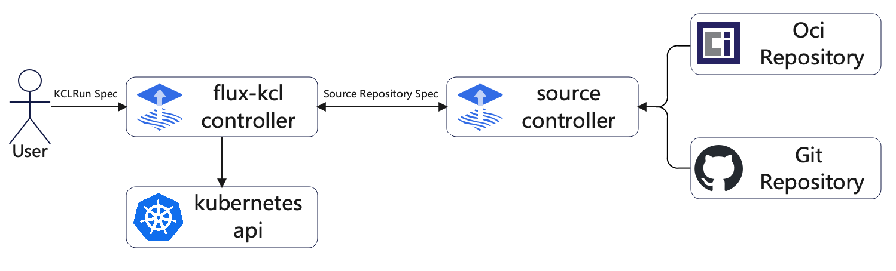

<h1 align="center">Flux KCL controller</h1>

<p align="center">
<a href="./README.md">English</a> | <a href="./README-zh.md">简体中文</a>
</p>


# 介绍

flux-kcl-controller 是一个组件，用于集成 [KCL](https://github.com/kcl-lang/kcl) 和 [Flux](https://github.com/fluxcd/flux2), 主要用来根据存储在 git/oci 仓库中的 KCL 程序定义的基础设施和工作负载，通过 [source-controller](https://github.com/fluxcd/source-controller) 获取 KCL 程序，实现基础设施和工作负载的持续交付。



# 特性

- 定期监控存储 KCL 程序的 git/oci 仓库，并根据 git 仓库中的变化，调谐 k8s 集群状态。
- 让标记为自动更新的镜像引用跟随对应的 [ImagePolicy](https://fluxcd.io/flux/components/image/image-reflector/#imagepolicies) 变化，无需向 Git 提交。

# 安装

控制器依赖 [Flux](https://github.com/fluxcd/flux2)，因为它需要依据 Flux 的 source CRD
（`GitRepository`、`OCIRepository`、`Bucket`）和 `Kustomization` 来调谐 KCLRun 对象。

## 使用 Flux（GitOps）

`install/rc.yaml` 是一个 `GitRepository` 和一个指向本仓库中 chart 的 `HelmRelease`，
因此不需要先把 chart 发布到任何 chart 仓库：

```shell
kubectl apply -f https://raw.githubusercontent.com/kcl-lang/flux-kcl-controller/main/install/rc.yaml
```

默认跟踪 `main` 分支。如果希望跟随某个发行版本，请将 `spec.chart.spec.ref` 固定到对应的 tag。

## 使用 Helm

```shell
helm install flux-kcl-controller ./charts/flux-kcl-controller \
  --namespace flux-system --create-namespace
```

## 使用 kustomize

```shell
kustomize build config/default | kubectl apply -f -
```

chart 支持的配置项见
[charts/flux-kcl-controller/README.md](./charts/flux-kcl-controller/README.md)。

# 快速开始

# 先决条件

## Linux/Mac 用户：
- k3d：用于创建 k8s 集群进行测试，如果您已经有 k8s 集群，可以跳过此步骤。
- Kustomize
- Kubectl

## Windows 用户：
**安装 WSL (Windows 子系统 Linux)：**
1. 以管理员身份打开 PowerShell 并运行：
   ```powershell
   wsl --install 
   ```
2. 重启您的计算机。
3. 打开 WSL 终端并安装所需工具：
```bash
sudo apt update
sudo apt install make kubectl git

# 安装 k3d
curl -s https://raw.githubusercontent.com/k3d-io/k3d/main/install.sh | bash

# 安装 kustomize
curl -s "https://raw.githubusercontent.com/kubernetes-sigs/kustomize/master/hack/install_kustomize.sh" | bash
sudo mv kustomize /usr/local/bin/
```

### 注意：所有后续命令在所有平台上都是相同的

## 创建测试用的 k8s 集群

通过如下命令创建集群：

```shell
k3d cluster create
```

## 下载 kcl-controller 并且安装到集群中

clone 本仓库到本地：

```shell
git clone https://github.com/kcl-lang/flux-kcl-controller.git
```

进入到本仓库的根目录：

```shell
cd flux-kcl-controller
```

将 kcl-controller 安装到集群中：

```shell
make deploy
```

## 监控一个 git 仓库

我们以仓库 https://github.com/awesome-kusion/kcl-deployment 为例，该仓库中存储了一个 KCL 程序，该程序定义了一个 Deployment，我们将使用 `flux-kcl-controller` 来部署该程序。

通过 `gitrepo.yaml` 文件，定义一个 `GitRepository` 对象，用来监控该仓库：

```yaml
apiVersion: source.toolkit.fluxcd.io/v1
kind: GitRepository
metadata:
  name: kcl-deployment
  namespace: source-system
spec:
  interval: 30s # 每隔 30s 检查一次仓库
  url: https://github.com/awesome-kusion/kcl-deployment.git
  ref:
    branch: main # 监控 main 分支
---
apiVersion: krm.kcl.dev.fluxcd/v1alpha1
kind: KCLRun
metadata:
  name: kcl-deployment
  namespace: source-system
spec:
  sourceRef:
    kind: GitRepository
    name: kcl-deployment
```

使用命令 `kubectl apply -f gitrepo.yaml` 将该对象部署到集群中。

## 查看部署结果

使用命令 `kubectl get deployment` 查看部署结果：

```shell
NAME               READY   UP-TO-DATE   AVAILABLE   AGE
nginx-deployment   1/1     1            0           28s
```

可以看到，kcl-controller 根据仓库中的 KCL 程序，创建了一个 Deployment。

## 更新仓库中的 KCL 程序

我们可以通过修改仓库中的 KCL 程序，来更新集群中的 Deployment。

修改仓库中的 KCL 程序，将 nginx 的版本从 `1.7.7` 修改为 `1.7.8`，将`deployment`的名字改为 `nginx-deployment-1`，并且提交到 main 分支。

具体变化可以参考:
[nginx:1.7.7 deployment](https://github.com/awesome-kusion/kcl-deployment/commit/dc8b2aa70b1b47bef0637212ea184792b8c43449) -> [nginx:1.7.8 deployment](https://github.com/awesome-kusion/kcl-deployment/commit/f257a71fdff6cb9190f49c1dbf5fa4496d7b3cb2)


使用命令 `kubectl get deployment` 查看部署结果：

```shell
NAME               READY   UP-TO-DATE   AVAILABLE   AGE
NAME                 READY   UP-TO-DATE   AVAILABLE   AGE
nginx-deployment     1/1     1            1           20m
nginx-deployment-1   1/1     1            0           4s
```

可以看到，`flux-kcl-controller` 根据仓库中的 KCL 程序，创建了一个 `nginx-deployment-1` 资源。

# 镜像自动更新

KCL 程序通常会固定它所部署的镜像版本。要让这些版本保持最新，就需要在每次
发布后修改程序并提交一次，而这正是镜像自动化想要消除的重复劳动。

控制器读取的是与 [image-automation-controller](https://fluxcd.io/flux/components/image/image-automation/)
在 Kustomization 中读取的相同的 `$imagepolicy` 标记。用
[ImagePolicy](https://fluxcd.io/flux/components/image/image-reflector/#imagepolicies)
的名称标注镜像，控制器会在编译前解析它：

```kcl
import manifests

nginx_image = "nginx:1.7.7"  # {"$imagepolicy": "flux-system:nginx"}

items = [
    {
        apiVersion = "apps/v1"
        kind = "Deployment"
        spec = {
            template = {
                spec = {
                    containers = [{
                        name = "nginx"
                        image = nginx_image
                    }]
                }
            }
        }
    }
]
manifests.yaml_stream(items)
```

## 标记的含义

标记作用于它前面的那个字符串字面量，因此不需要写字段路径：注释的位置本身就
标识了要修改的值。同一个引用的其他出现位置不会被修改，这样一个程序就可以
既保留某个刻意固定的镜像，又让另一个跟随策略变化。

策略名可以写成 `namespace:name`；省略命名空间时，从 `KCLRun` 所在的命名空间
读取 ImagePolicy。

策略可以更新 **tag** 或 **digest**，但不能更新 **仓库**。registry 和路径属于
作者，因此解析到另一个仓库的策略要么是笔误，要么是在试图把工作负载重定向到
别处，此时 `KCLRun` 会被挂起而不是被应用。

## 行为

| 情况 | 结果 |
| --- | --- |
| 策略选中了新的 tag 或 digest | 被标记的字面量跟随变化，`KCLRun` 重新应用。 |
| 策略不存在，或尚未报告镜像 | 重试。`KCLRun` 报告 `ImagePolicyNotReady`。 |
| 策略解析到另一个仓库 | 以 `ImagePolicyFailed` 进入 `Stalled`，不应用任何内容。 |
| 标记格式错误，或没有标注到镜像 | 以 `ImagePolicyFailed` 进入 `Stalled`，不应用任何内容。 |

只要一个可能被子运行的策略选中了新的镜像，`KCLRun` 就会立即重新调谐，因此
更新不必等待调谐间隔。

## 需要安装什么

控制器需要 ImagePolicy API，读取它需要相应的 RBAC。使用 `make deploy` 或
发布清单安装控制器即可覆盖这两项。如果你自行管理 RBAC，需要授予：

```yaml
- apiGroups:
  - image.toolkit.fluxcd.io
  resources:
  - imagepolicies
  verbs:
  - get
  - list
  - watch
```

`image-reflector-controller` 和 `image-automation-controller` 本身不是必需的。
对于 `KCLRun` 的来源，本功能取代了 automation controller，因此针对同一个
程序同时运行两者是多余的。

## 示例

```yaml
apiVersion: image.toolkit.fluxcd.io/v1
kind: ImagePolicy
metadata:
  name: nginx
  namespace: flux-system
spec:
  imageRepositoryRef:
    name: nginx
  policy:
    semver:
      range: ">=1.7.0"
```

有了这个策略，上面的 `Deployment` 会收敛到该范围选中的最新 tag，无需向仓库
提交任何改动。
