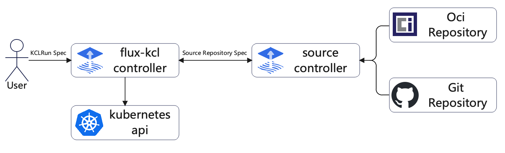

<h1 align="center">Flux KCL controller</h1>

<p align="center">
<a href="./README.md">English</a> | <a href="./README-zh.md">简体中文</a>
</p>

[](https://app.fossa.com/projects/git%2Bgithub.com%2Fkcl-lang%2Fflux-kcl-controller?ref=badge_shield)

# Introduction

The `flux-kcl-controller` is a component developed for the integration of [KCL](https://github.com/kcl-lang/kcl) and [Flux](https://github.com/fluxcd/flux2), designed to orchestrate continuous delivery pipelines for infrastructure and workloads defined with KCL based on the [source-controller](https://github.com/fluxcd/source-controller), [kustomize-controller](https://github.com/fluxcd/kustomize-controller) and [helm-controller](https://github.com/fluxcd/helm-controller) to acquire the KCL program from repositories.



# Features

- Periodically monitor git repositories that store KCL programs and reconcile k8s cluster status according to changes in git repositories.
- Keep the image references marked for update in step with the [ImagePolicies](https://fluxcd.io/flux/components/image/image-reflector/#imagepolicies) watching them, without a commit to Git.
- Pull KCL module dependencies from a private OCI registry, using the same docker-registry Secret Flux uses for an `OCIRepository`.

# Installation

The controller requires [Flux](https://github.com/fluxcd/flux2) to be installed
first, because it reconciles KCLRun objects against the Flux source CRDs
(`GitRepository`, `OCIRepository`, `Bucket`) and `Kustomization`.

## With Flux (GitOps)

`install/rc.yaml` is a `GitRepository` and a `HelmRelease` pointing at the chart
in this repository, so nothing has to be published to a chart registry first:

```shell
kubectl apply -f https://raw.githubusercontent.com/kcl-lang/flux-kcl-controller/main/install/rc.yaml
```

It tracks `main` by default. Pin `spec.chart.spec.ref` to a tag if you would
rather follow a release.

## With Helm

```shell
helm install flux-kcl-controller ./charts/flux-kcl-controller \
  --namespace flux-system --create-namespace
```

## With kustomize

```shell
kustomize build config/default | kubectl apply -f -
```

See [charts/flux-kcl-controller/README.md](./charts/flux-kcl-controller/README.md)
for the values the chart accepts.

# Quick Start

## Prerequisites

### For Linux/Mac Users:
- k3d: used to create a k8s cluster for testing, if you already have a k8s cluster, you can skip ignore this.
- Kustomize
- Kubectl

### For Windows Users:
**Install WSL (Windows Subsystem for Linux):**
1. Open PowerShell as Administrator and run:
   ```powershell
   wsl --install 
2. Restart your computer.
3. Open WSL terminal and install required tools:
``` 
sudo apt update
sudo apt install make kubectl git

# Install k3d
curl -s https://raw.githubusercontent.com/k3d-io/k3d/main/install.sh | bash

# Install kustomize
curl -s "https://raw.githubusercontent.com/kubernetes-sigs/kustomize/master/hack/install_kustomize.sh" | bash
sudo mv kustomize /usr/local/bin/
```
### Note: All subsequent commands are the same for all platforms

## Create a test k8s cluster

Create a cluster using the following command:

```shell
k3d cluster create
```

## Download kcl-controller and install it into the cluster

Clone this repository to local:

```shell
git clone https://github.com/kcl-lang/flux-kcl-controller.git
```

Enter the root directory of this repository:

```shell
cd flux-kcl-controller
```

Install kcl-controller into the cluster:

```shell
make deploy
```

## Monitor a git repository

Take the GitHub repository https://github.com/awesome-kusion/kcl-deployment as an example. This repository stores a KCL program that defines a `Deployment`. We will use `flux-kcl-controller` to deploy this program.

Define a `GitRepository` object through the `gitrepo.yaml` file to monitor the repository:

```yaml
apiVersion: source.toolkit.fluxcd.io/v1
kind: GitRepository
metadata:
  name: kcl-deployment
  namespace: source-system
spec:
  interval: 30s
  url: https://github.com/awesome-kusion/kcl-deployment.git
  ref:
    branch: main
---
apiVersion: krm.kcl.dev.fluxcd/v1alpha1
kind: KCLRun
metadata:
  name: kcl-deployment
  namespace: source-system
spec:
  sourceRef:
    kind: GitRepository
    name: kcl-deployment
```

Use the command `kubectl apply -f gitrepo.yaml` to deploy the object to the cluster.

## View the deployment result

Use the command `kubectl get deployment` to view the deployment result:

```shell
NAME               READY   UP-TO-DATE   AVAILABLE   AGE
nginx-deployment   1/1     1            0           28s
```

The `nginx-deployment` is deployed successfully.

## Update the KCL program in the repository

We can update the `Deployment` in the cluster by modifying the KCL program in the repository.

Change the version of nginx from `1.7.7` to `1.7.8` and the name of `deployment` to `nginx-deployment-1`, and commit to the main branch.

The changes can be referred to: [nginx:1.7.7 deployment](https://github.com/awesome-kusion/kcl-deployment/commit/dc8b2aa70b1b47bef0637212ea184792b8c43449) -> [nginx:1.7.8 deployment](https://github.com/awesome-kusion/kcl-deployment/commit/f257a71fdff6cb9190f49c1dbf5fa4496d7b3cb2)

Use the command `kubectl get deployment` to view the deployment result:


```shell
NAME                 READY   UP-TO-DATE   AVAILABLE   AGE
nginx-deployment     1/1     1            1           20m
nginx-deployment-1   1/1     1            0           4s
```

`flux-kcl-controller` creates a `nginx-deployment-1` according to the KCL program in the repository.

# Image update automation

A KCL program usually pins the images it deploys. Keeping those pins current
means editing the program and committing on every release, which is exactly the
churn image automation is meant to remove.

The controller reads the same `$imagepolicy` marker that
[image-automation-controller](https://fluxcd.io/flux/components/image/image-automation/)
reads from a Kustomization. Annotate the image with the name of an
[ImagePolicy](https://fluxcd.io/flux/components/image/image-reflector/#imagepolicies),
and the controller resolves it before compiling:

```kcl
import manifests

nginx_image = "nginx:1.7.7"  # {"$imagepolicy": "flux-system:nginx"}

items = [
    {
        apiVersion = "apps/v1"
        kind = "Deployment"
        spec = {
            template = {
                spec = {
                    containers = [{
                        name = "nginx"
                        image = nginx_image
                    }]
                }
            }
        }
    }
]
manifests.yaml_stream(items)
```

## What the marker means

The marker annotates the string literal immediately before it, so no field path
is needed: the position of the comment identifies the value to change. Every
other occurrence of the same reference is left alone, which lets a program keep
one image pinned deliberately and let another follow the policy.

A policy name may be written as `namespace:name`; without a namespace, the
ImagePolicy is read from the namespace of the `KCLRun`.

A policy may update the **tag** or the **digest**, never the **repository**. The
registry and the path belong to the author, so a policy that resolves to a
different repository is a mistake or an attempt to redirect the workload
somewhere else, and the `KCLRun` is held instead of applied.

## How it behaves

| Situation | Result |
| --- | --- |
| Policy elects a new tag or digest | The marked literal follows it, and the `KCLRun` re-applies. |
| Policy does not exist, or has not reported an image | Retried. The `KCLRun` reports `ImagePolicyNotReady`. |
| Policy resolves to another repository | `Stalled` with `ImagePolicyFailed`. Nothing is applied. |
| Marker is malformed, or annotates no image | `Stalled` with `ImagePolicyFailed`. Nothing is applied. |

A `KCLRun` is reconciled again as soon as a policy it may reference elects a new
image, so an update does not wait for the reconciliation interval.

## What to install

The controller needs the ImagePolicy API, and reading it needs RBAC. Installing
the controller with `make deploy` or the release manifest covers both. If you
manage RBAC yourself, grant:

```yaml
- apiGroups:
  - image.toolkit.fluxcd.io
  resources:
  - imagepolicies
  verbs:
  - get
  - list
  - watch
```

The `image-reflector-controller` and `image-automation-controller` themselves
are not required. This feature replaces the automation controller for `KCLRun`
sources, so running both against the same program is redundant.

## Example

```yaml
apiVersion: image.toolkit.fluxcd.io/v1
kind: ImagePolicy
metadata:
  name: nginx
  namespace: flux-system
spec:
  imageRepositoryRef:
    name: nginx
  policy:
    semver:
      range: ">=1.7.0"
```

With that policy in place, the `Deployment` above converges on the newest tag the
range selects, with no commit to the repository.

# Private OCI modules

A KCL program can depend on modules stored in an OCI registry. Public modules
are fetched with no extra configuration. A private registry answers `401` or
`403` until the controller can log in, which is what `spec.ociAuth` is for.

The credential is a Kubernetes Secret of type `kubernetes.io/dockerconfigjson`:
the same object [Flux `OCIRepository.spec.secretRef`](https://fluxcd.io/flux/components/source/ocirepositories/#secret-reference)
uses, and the same object you would attach to a ServiceAccount as an
`imagePullSecret`. It lives in the same namespace as the `KCLRun`.

```shell
kubectl create secret docker-registry ghcr-modules \
  --namespace flux-system \
  --docker-server=ghcr.io \
  --docker-username=robot \
  --docker-password="$GITHUB_TOKEN"
```

```yaml
apiVersion: krm.kcl.dev.fluxcd/v1alpha1
kind: KCLRun
metadata:
  name: app
  namespace: flux-system
spec:
  interval: 5m
  prune: true
  sourceRef:
    kind: GitRepository
    name: app
  ociAuth:
    secretRefs:
      - name: ghcr-modules
```

One Secret can log in to several registries (`--docker-server` is one host per
Secret; create another Secret, or one config with several `auths` entries, and
list each under `secretRefs`). A dependency then names the registry in
`kcl.mod`:

```toml
[dependencies]
mylib = { oci = "oci://ghcr.io/my-org/mylib", tag = "0.1.0" }
```

## Service account image pull secrets

If those Secrets are already attached to a ServiceAccount, point `ociAuth` at
the account instead of repeating them. This is the same mechanism as
`OCIRepository.spec.serviceAccountName`.

```yaml
apiVersion: v1
kind: ServiceAccount
metadata:
  name: kcl-modules
  namespace: flux-system
imagePullSecrets:
  - name: ghcr-modules
```

```yaml
spec:
  ociAuth:
    serviceAccountName: kcl-modules
```

`spec.ociAuth.serviceAccountName` only selects registry credentials. The
account impersonated when the rendered manifests are applied is still
`spec.serviceAccountName`.

`secretRefs` and `serviceAccountName` can both be set. Their credentials are
combined, and two different passwords for the same registry host are rejected.

## What to expect

| Situation | Result |
| --- | --- |
| No `ociAuth`, public modules | Pulled anonymously. |
| Secret or ServiceAccount not found yet | Retried. The `KCLRun` reports `RegistryAuthFailed`. |
| Registry rejects the credentials | Retried. The compile error is reported as `FetchFailed`. |
| Secret updated | Picked up on the next reconciliation. Set `reconcile.fluxcd.io/requestedAt` on the `KCLRun` to run one immediately. |

The controller reads the Secret by name. It does not require the
`reconcile.fluxcd.io/watch=Enabled` label.
